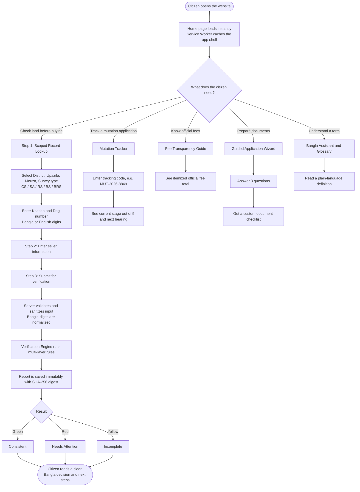
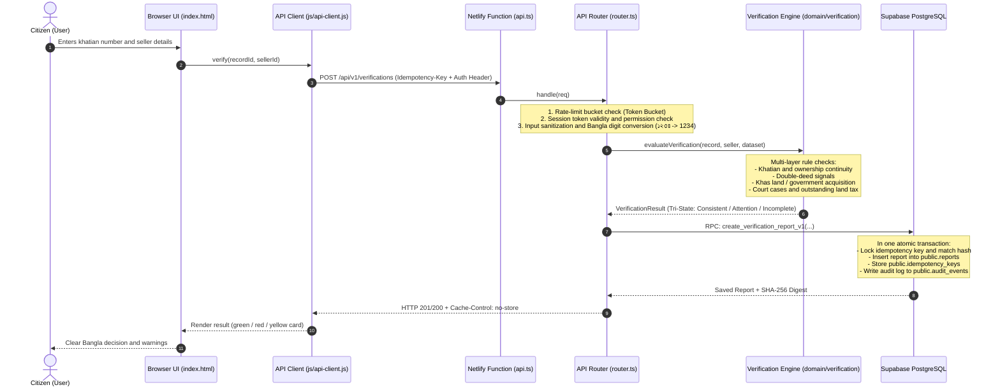

# Smart Bhumi Seba (স্মার্ট ভূমি সেবা)
### A Citizen-Friendly Pre-Purchase Land Verification & Digital Service Platform for Bangladesh

[](https://github.com/logic-forge119/Smart-Vumi-Sheba)
[](https://www.netlify.com)
[](https://supabase.com)
[](https://vitest.dev)
[](LICENSE)

> **One-line pitch:** Before you pay for land, check it in plain Bangla, from your own home, in under a minute.

---

## Table of Contents

1. [The Problem](#1-the-problem)
2. [Our Solution](#2-our-solution)
3. [Highlights at a Glance](#3-highlights-at-a-glance)
4. [How It Works: The Complete User Journey](#4-how-it-works-the-complete-user-journey)
5. [Features and Citizen Benefits](#5-features-and-citizen-benefits)
6. [System Architecture](#6-system-architecture)
7. [Data Flow: Request to Result](#7-data-flow-request-to-result)
8. [Verification Engine and Outcomes](#8-verification-engine-and-outcomes)
9. [Security and Data Integrity](#9-security-and-data-integrity)
10. [Installation and Local Setup](#10-installation-and-local-setup)
11. [Testing Suite](#11-testing-suite)
12. [Future Roadmap](#12-future-roadmap)
13. [License and Disclaimer](#13-license-and-disclaimer)

---

## 1. The Problem

When buying land or checking land records in Bangladesh, ordinary citizens struggle with complex legal terminology and unclear records. They are often exploited by brokers and middlemen. Common fraud patterns include:

- **Double sale:** the same plot is sold to more than one buyer.
- **Khas / government-acquired land** transferred through forged deeds.
- **Hidden litigation:** land sold while a court case is pending and undisclosed.
- **Overcharging:** informal fees demanded above the official government rate.

Most buyers have no easy way to check any of this *before* they pay.

## 2. Our Solution

**Smart Bhumi Seba** is a modern, citizen-friendly web platform that lets anyone verify the real condition of a piece of land **before buying it**, in **simple Bangla**, with **transparent results**, from home.

It is an independent technology prototype built to raise citizen awareness. It is **not** a replacement for any government institution or official portal.

---

## 3. Highlights at a Glance

| Area | What we built |
| :--- | :--- |
| **Core value** | Pre-purchase land verification with a clear three-state result |
| **Language** | Bangla-first UI, Bangla and English digits both accepted |
| **Accessibility** | Semantic HTML, screen-reader friendly, high-contrast mode |
| **Reliability** | Offline-first PWA with draft saving and auto-sync |
| **Trust** | Immutable reports with SHA-256 digests; idempotent submissions |
| **Security** | Row Level Security, no direct browser-to-database access, rate limiting, request-size caps |
| **Architecture** | JAMstack + Serverless (Netlify Functions + Supabase PostgreSQL) |
| **Quality** | 44 automated tests + 8 live database integration tests |

---

## 4. How It Works: The Complete User Journey

This section follows one citizen from the moment they open the website to the final report on their screen.

### Journey Overview



### Step-by-Step Walkthrough

#### Step 0: Arrival
1. The citizen opens the site on a phone or computer. The page is plain HTML, CSS and JavaScript, so it loads fast even on weak connections.
2. A **Service Worker** (`sw.js`) caches the app shell and offline forms in the background. From the second visit onward the app opens even without internet.
3. The interface is in Bangla. A high-contrast mode and screen-reader-friendly structure are available.

#### Step 1: Choose a service
From the home screen the citizen picks what they need: **verify land**, **track a mutation (namjari)**, **check fees**, **prepare documents**, or **look up a term**.

#### Step 2: Scoped record lookup (the foundation of verification)
1. The citizen selects **District → Upazila → Mouza** and the **survey type** (CS, SA, RS, BS or BRS).
2. They enter the **Khatian number** and **Dag number**. Both Bangla (১২৩৪) and English (1234) digits work.
3. Scoping matters: the same dag number can exist in a different mouza or a different survey. Filtering by all of these prevents the citizen from reading the wrong plot's data.

#### Step 3: Enter seller information
The citizen provides the seller's identifying details so the engine can check whether the seller matches the recorded ownership chain.

#### Step 4: Submit for verification
1. The browser sends one secured request, carrying an **Idempotency-Key** and an authorization header, to the serverless API.
2. If the connection drops mid-way, the draft is kept locally and synced automatically later. If the same request is sent twice, the system returns the original result rather than creating a duplicate.

#### Step 5: What happens on the server (invisible to the user)
1. **Guards:** rate-limit check (token bucket), session and permission check, content-type check, 32 KiB request-size cap.
2. **Sanitization:** input is cleaned and Bangla digits are converted to standard digits.
3. **Rules engine** evaluates the case across several layers:
   - Khatian and ownership continuity
   - Double-sale signals
   - Khas land / government acquisition
   - Court cases and outstanding land tax
4. **Atomic save:** a single database transaction stores the report, the idempotency record and an audit log entry together.
5. **Integrity:** a SHA-256 digest is generated for the report, and the report becomes permanently immutable.

#### Step 6: Final output, the result card
The citizen sees a clear Bangla decision with a color-coded card:

| Card | Outcome | Meaning for the citizen |
| :--- | :--- | :--- |
| 🟢 Green | **Consistent** | The checked records line up; no conflicting signals were found in the dataset. |
| 🔴 Red | **Needs Attention** | One or more risk signals were found (e.g., double-sale signal, khas land, pending case). Do not proceed without professional or official confirmation. |
| 🟡 Yellow | **Incomplete** | Not enough data to decide. The citizen is told what is missing. |

The report is stored immutably and can be used later as a reference in any dispute.

#### Other journeys

- **Mutation Tracker:** enter a code such as `MUT-2026-8849` to see which of the **5 stages** the application is in (Application Submitted → Verification → Investigation → Hearing → Approval), how long it has been pending, and the next hearing status.
- **Fee Transparency:** see the official namjari fee itemized: Application fee ৳20 + Notice ৳50 + Record correction & DCR ৳1,100 = **৳1,170 total**.
- **Guided Application Wizard:** answer 3 questions (source of land, type of deed, possession status) and receive a personalized document checklist.
- **Assistant & Glossary:** plain-Bangla definitions of Khatian, Baya Deed, Porcha, Dag, CS, RS, BS, DCR and more.

---

## 5. Features and Citizen Benefits

| # | Feature | What it does | How it helps citizens |
| :-- | :--- | :--- | :--- |
| 1 | **Pre-Purchase Verification** | Server-side engine analyzes khatian, deed, mutation, khas land and case records, and returns one of three outcomes: **Consistent**, **Attention**, **Incomplete**. | Reveals double-sale risk, khas/acquisition problems and pending cases before money is spent. |
| 2 | **Scoped Record Lookup** | Filter by district, upazila, mouza and survey (CS, SA, RS, BS, BRS) plus khatian and dag number. Bangla and English digits supported. | Removes confusion between plots that share a dag number across mouzas or surveys. |
| 3 | **Mutation Tracker** | Track an application by code (e.g., `MUT-2026-8849`) through 5 stages. | Know where the file is, how long it has waited, and when the hearing is, with fewer trips to the office. |
| 4 | **Fee Transparency** | Itemized official namjari fees (৳20 + ৳50 + ৳1,100 = ৳1,170). | Protects citizens from brokers and extra unofficial charges. |
| 5 | **Guided Application Wizard** | 3 simple questions generate a custom document checklist. | Even a low-literacy user knows exactly what to bring to the office. |
| 6 | **Offline-First PWA & Drafts** | Drafts are saved locally and auto-synced when the connection returns. | No data loss in remote areas with poor internet. |
| 7 | **Bangla Assistant & Glossary** | Plain-language definitions of complex land terms. | Citizens understand their own rights and documents. |
| 8 | **Immutable Reports & Idempotency** | Each report gets a SHA-256 digest; resubmitting the same request never creates duplicates. | Reports stay trustworthy and can be referenced in any later dispute. |

---

## 6. System Architecture

Built on **JAMstack + Serverless** principles for speed, no cold-start complexity, and strong security.

```
                                  +------------------------------------------+
                                  |            Client / Browser              |
                                  |  (HTML5 + Vanilla CSS3 + Vanilla JS PWA) |
                                  +--------------------+---------------------+
                                                       |
                                           HTTPS / REST API Calls
                                                       |
                                                       v
+----------------------------------------------------------------------------------------------------+
|                                      Netlify Edge & Serverless                                     |
|                                                                                                    |
|  +--------------------+     +-----------------------------+     +-------------------------------+  |
|  |   Static Assets    |     |    API Router & Validation  |     |      Security & Guards        |  |
|  | (dist/public & SW) |     | (server/router.ts, Zod v1)  |     | (Rate Limit, Cache-Control)   |  |
|  +--------------------+     +--------------+--------------+     +---------------+---------------+  |
+--------------------------------------------|------------------------------------|------------------+
                                             |                                    |
                                  Verified Server-Side Calls                      |
                                             |                                    |
                                             v                                    v
+----------------------------------------------------------------------------------------------------+
|                                  Supabase Backend & PostgreSQL 15+                                 |
|                                                                                                    |
|  +--------------------+     +-----------------------------+     +-------------------------------+  |
|  |    GoTrue Auth     |     |   Relational Tables (17)    |     |    Atomic RPCs & Triggers     |  |
|  | (Session & Tokens) |     |   (Parcels, Khatians, RLS)  |     | (create_report, rate_limits)  |  |
|  +--------------------+     +-----------------------------+     +-------------------------------+  |
+----------------------------------------------------------------------------------------------------+
```

### Technology Components

**1. Frontend**
- **Structure:** Vanilla HTML5, semantic and screen-reader friendly, with Bangla accessibility.
- **Styling:** Custom CSS3 responsive design system, green-white palette (`#07634d`), high-contrast mode.
- **Logic:** Vanilla JavaScript (ES Modules), no heavy framework overhead.
- **PWA & Offline:** Service Worker (`sw.js`) caches the app shell and offline forms.

**2. Backend (Serverless Layer)**
- **Runtime:** Node.js (TypeScript) on Netlify Functions (`netlify/functions/api.ts`).
- **API Router:** Lightweight custom router (`server/router.ts`) handling request size (32 KiB cap), content type and Bangla-digit normalization.
- **Validation:** Zod schema validation (`server/validation/index.ts`).

**3. Database & Security Layer (Supabase)**
- **PostgreSQL 15+:** relational schema (16 core tables + 1 rate-limit table).
- **Row Level Security (RLS):** direct browser-to-database access is blocked (`anon` and `authenticated` roles revoked); only the backend `service_role` can access data.
- **Immutability triggers:** once created, a report cannot be changed at the database level (`fn_prevent_report_modification`).
- **Published dataset freeze:** records in a published dataset can never be modified or deleted.

---

## 7. Data Flow: Request to Result



---

## 8. Verification Engine and Outcomes

The engine (`domain/verification`) is a deterministic, rule-based module that runs on the server. It never trusts client-side logic.

**Checks performed**
1. Khatian and ownership-chain continuity
2. Double-deed (double-sale) signals
3. Khas land and government acquisition status
4. Pending court cases
5. Outstanding land tax (khajna)

**Tri-state result**

| State | Card | Description |
| :--- | :--- | :--- |
| **Consistent** | 🟢 Green | Records are consistent with no conflicting signals in the dataset. |
| **Attention** | 🔴 Red | At least one risk signal requires attention before purchase. |
| **Incomplete** | 🟡 Yellow | Data is insufficient; the user is told what is missing. |

> The project runs in `DATA_MODE=synthetic` by default, using a demo dataset. Results are for awareness and demonstration, not legal advice.

---

## 9. Security and Data Integrity

| Layer | Protection |
| :--- | :--- |
| **Database access** | RLS enabled; `anon` and `authenticated` roles revoked; only server-side `service_role` can read or write. |
| **Request hardening** | 32 KiB body cap, content-type enforcement, Zod schema validation, input sanitization. |
| **Abuse prevention** | Token-bucket rate limiting backed by a database table. |
| **Caching** | `Cache-Control: no-store` on sensitive API responses. |
| **Integrity** | Reports are immutable via DB trigger; each carries a SHA-256 digest. |
| **Duplicate safety** | Idempotency keys with hash matching ensure repeated submissions are safe. |
| **Auditability** | Every report creation writes an event to `audit_events`. |
| **Dataset safety** | Published datasets are frozen against edits and deletes. |
| **Secrets** | `.env` is in `.gitignore`; secrets never enter Git. |

---

## 10. Installation and Local Setup

### Requirements
- **Node.js** v20.x or later
- **npm** v10.x or later
- **Git**
- A free **Supabase** account ([supabase.com](https://supabase.com))

### Step 1: Clone the repository
```bash
git clone https://github.com/logic-forge119/Smart-Vumi-Sheba.git
cd Smart-Vumi-Sheba
```

### Step 2: Install dependencies
```bash
npm install
```

### Step 3: Configure environment variables (`.env`)
Create a `.env` file in the project root (it is in `.gitignore`, so secrets never reach Git):
```env
SUPABASE_URL=https://<your-project-id>.supabase.co
SUPABASE_PUBLISHABLE_KEY=<your-anon-publishable-key>
SUPABASE_SERVICE_ROLE_KEY=<your-service-role-secret-key>
NODE_ENV=development

DATA_MODE=synthetic
ACTIVE_DATASET_VERSION=synthetic-v2
ACTIVE_RULES_VERSION=v1
ALLOWED_ORIGINS=http://localhost:8888,http://localhost:3000
```

### Step 4: Apply the database schema and seed data
In the Supabase dashboard **SQL Editor**, run these two files in order:
1. `supabase/migrations/20261015000000_init_schema.sql` (creates tables, indexes, RLS and atomic RPCs)
2. `supabase/seed.sql` (loads the demo dataset and sample cases)

### Step 5: Start the local development server
```bash
npm run dev
```
Then open: **http://localhost:8888**

---

## 11. Testing Suite

```bash
# 1. Full unit, security and rules-engine tests (44 tests)
npm test

# 2. Live Supabase database integration tests (8 live DB tests)
npm run test:supabase

# 3. TypeScript compilation and type check
npm run typecheck

# 4. Production build check
npm run build
```

---

## 12. Future Roadmap

- [ ] **Government land portal API integration:** connect to live records once the Ministry of Land's central API gateway and open data become available.
- [ ] **Strict nonce-based CSP migration:** move all inline event handlers to `data-action` delegation and remove `'unsafe-inline'`.
- [ ] **Interactive GIS mouza map:** show plot boundaries and measurements on a satellite map using GPS coordinates for each dag.
- [ ] **AI-powered document scanner (OCR):** photograph an old or handwritten deed and have the system extract dag, khatian and transfer date into the verification form.
- [ ] **SMS and WhatsApp notifications:** automatic Bangla messages to the citizen's phone at each mutation stage change.
- [ ] **Full multilingual support (Bangla and English toggle):** a complete English version for international buyers and the Bangladeshi diaspora.

---

## 13. License and Disclaimer

- **License:** Released under the [MIT License](LICENSE).
- **Disclaimer:** This is a technology demo and prototype built for citizen welfare. It is **not** an official government website and performs **no** government financial transactions. For official land applications, please contact the relevant government portal.
