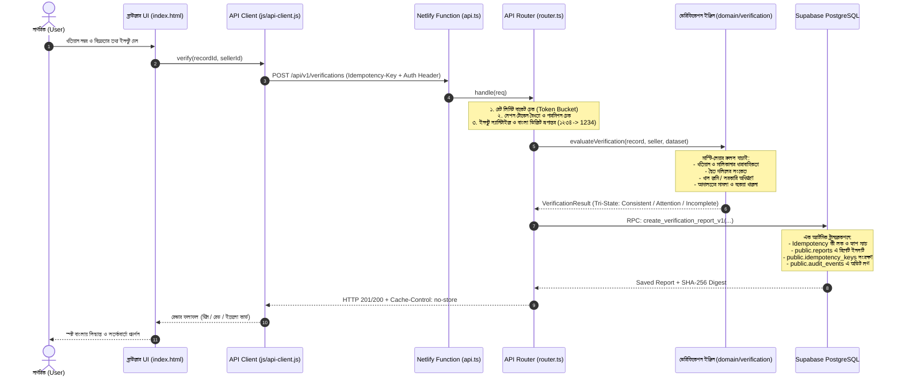

# স্মার্ট ভূমি সেবা (Smart Bhumi Seba)
### নাগরিকবান্ধব ভূমি যাচাই ও ডিজিটাল সেবা প্ল্যাটফর্ম (Citizen Pre-Purchase Land Verification Platform)

[](https://github.com/logic-forge119/Smart-Vumi-Sheba)
[](https://www.netlify.com)
[](https://supabase.com)
[](https://vitest.dev)
[](LICENSE)

---

## ১. আমরা কী নিয়ে কাজ করছি? (Project Overview)

বাংলাদেশে জমি কেনাবেচা বা ভূমির তথ্য জানার ক্ষেত্রে সাধারণ নাগরিকরা প্রায়শই জটিল আইনি পরিভাষা, অস্পষ্ট রেকর্ড এবং মধ্যস্বত্বভোগী বা দালালের খপ্পরে পড়ে প্রতারণার শিকার হন। অনেক ক্ষেত্রে একই জমি একাধিক ব্যক্তির কাছে বিক্রি (Double Sale), খাস বা সরকারি অধিগ্রহণকৃত জমি জাল দলিলের মাধ্যমে হস্তান্তর, অথবা চলমান মামলার তথ্য গোপন করে জমি বিক্রির মতো ঘটনা ঘটে।

**স্মার্ট ভূমি সেবা** হলো একটি নাগরিকবান্ধব ও আধুনিক ওয়েব প্ল্যাটফর্ম, যার মূল লক্ষ্য জমি কেনার আগেই যেকোনো সাধারণ মানুষকে সহজ বাংলায়, স্বচ্ছভাবে এবং ঘরে বসেই জমির প্রকৃত অবস্থা যাচাই করার সুযোগ দেওয়া। এটি কোনো সরকারি প্রাতিষ্ঠানিক বিকল্প নয়, বরং নাগরিক সচেতনতা বৃদ্ধিতে একটি স্বতন্ত্র প্রযুক্তিগত প্রোটোটাইপ।

---

## ২. আর্কিটেকচার (System Architecture)

সিস্টেমটি আধুনিক **JAMstack ও Serverless Architecture** নীতিতে গঠিত, যা দ্রুতগতি, শূন্য কোল্ড-স্টার্ট জটিলতা এবং সর্বোচ্চ নিরাপত্তা নিশ্চিত করে।

```
                                  +------------------------------------------+
                                  |            Client / Browser              |
                                  |  (HTML5 + Vanilla CSS3 + Vanilla JS PWA) |
                                  +--------------------+---------------------+
                                                       |
                                           HTTPS / REST API Calls
                                                       |
                                                       v
+----------------------------------------------------------------------------------------------------+
|                                      Netlify Edge & Serverless                                     |
|                                                                                                    |
|  +--------------------+     +-----------------------------+     +-------------------------------+  |
|  |   Static Assets    |     |    API Router & Validation  |     |      Security & Guards        |  |
|  | (dist/public & SW) |     | (server/router.ts, Zod v1)  |     | (Rate Limit, Cache-Control)   |  |
|  +--------------------+     +--------------+--------------+     +---------------+---------------+  |
+--------------------------------------------|------------------------------------|------------------+
                                             |                                    |
                                  Verified Server-Side Calls                      |
                                             |                                    |
                                             v                                    v
+----------------------------------------------------------------------------------------------------+
|                                  Supabase Backend & PostgreSQL 15+                                 |
|                                                                                                    |
|  +--------------------+     +-----------------------------+     +-------------------------------+  |
|  |    GoTrue Auth     |     |   Relational Tables (17)    |     |    Atomic RPCs & Triggers     |  |
|  | (Session & Tokens) |     |   (Parcels, Khatians, RLS)  |     | (create_report, rate_limits)  |  |
|  +--------------------+     +-----------------------------+     +-------------------------------+  |
+----------------------------------------------------------------------------------------------------+
```

### প্রযুক্তিগত উপাদানসমূহ:
1. **Frontend:**
   - **Structure:** ভ্যানিলা HTML5 (Semantic, Screen-reader Friendly, Bangla Accessibility)।
   - **Styling:** কাস্টম CSS3 (Responsive Design System, Green-White Palette `#07634d`, High-contrast Mode)।
   - **Logic:** Vanilla JavaScript (ES Modules, কোনো ভারী ফ্রন্টএন্ড ফ্রেমওয়ার্ক ওভারহেড নেই)।
   - **PWA & Offline:** Service Worker (`sw.js`) যা মূল শেল ও অফলাইন ফর্ম ক্যাশ করে রাখে।
2. **Backend (Serverless Layer):**
   - **Runtime:** Node.js (TypeScript) Netlify Functions (`netlify/functions/api.ts`)।
   - **API Router:** কাস্টম লাইটওয়েট রাউটার (`server/router.ts`) যা রিকোয়েস্ট সাইজ (৩২ KiB ক্যাপ), কন্টেন্ট-টাইপ এবং বাংলা ডিজিট নরমালাইজেশন পরিচালনা করে।
   - **Validation:** Zod স্কিমা ভ্যালিডেশন (`server/validation/index.ts`)।
3. **Database & Security Layer (Supabase):**
   - **PostgreSQL 15+:** রিলেশনাল স্কিমা (১৬টি কোর টেবিল + ১টি রেট লিমিট টেবিল)।
   - **Row Level Security (RLS):** ব্রাউজার থেকে সরাসরি ডাটাবেজ এক্সেস নিষিদ্ধ (`anon` ও `authenticated` রিভোকড); শুধুমাত্র ব্যাকএন্ড `service_role` দিয়ে নিরাপদ এক্সেস।
   - **Immutability Triggers:** একবার তৈরি হওয়া রিপোর্ট ডাটাবেজ লেভেলে অপরিবর্তনীয় (`fn_prevent_report_modification`)।
   - **Published Dataset Freeze:** প্রকাশিত ডেটাসেটের রেকর্ড কোনো অবস্থাতেই মডিফাই বা ডিলিট করা যায় না।

---

## ৩. ডাটা ফ্লো (Data Flow Diagram)

একটি জমি যাচাই রিকোয়েস্ট কীভাবে ক্লায়েন্ট থেকে ডাটাবেজ এবং রেসপন্সে রূপান্তর হয়, তা নিচে দেখানো হলো:



---

## ৪. কী কী ফিচার যুক্ত করা হয়েছে এবং কীভাবে নাগরিকদের সাহায্য করবে?

| ফিচার | বিবরণ ও কাজের ধরন | নাগরিকের যেভাবে সাহায্য করবে (Citizen Benefit) |
| :--- | :--- | :--- |
| **১. কেনার আগে যাচাই (Pre-Purchase Verification)** | সার্ভার-সাইড ভেরিফিকেশন ইঞ্জিন যা খতিয়ান, দলিল, নামজারি, খাস জমি ও মামলার রেকর্ড বিশ্লেষণ করে ৩টি আউটকামে ভাগ করে: **সামঞ্জস্যপূর্ণ**, **সতর্কতা** বা **অসম্পূর্ণ**। | জমি কেনার পূর্বে নাগরিক বুঝতে পারেন জমিটিতে কোনো দ্বৈত বিক্রির ঝুঁকি, খাস বা অধিগ্রহণের ঝামেলা কিংবা পেন্ডিং মামলা আছে কি না। |
| **২. সঠিক পরিসরে অনুসন্ধান (Scoped Record Lookup)** | জেলা, উপজেলা, মৌজা ও জরিপ (CS, SA, RS, BS, BRS) নির্দিষ্ট করে খতিয়ান ও দাগ নম্বর দিয়ে ফিল্টার করা যায়। বাংলা ও ইংরেজি উভয় ডিজিট সমর্থিত। | ভিন্ন মৌজা বা ভিন্ন জরিপের একই দাগ নম্বরের জমির তথ্যে বিভ্রান্তি দূর করে এবং সঠিক প্লটের তথ্য তৎক্ষণাৎ প্রদর্শন করে। |
| **৩. নামজারি ট্র্যাকিং (Mutation Tracker)** | নামজারি ট্র্যাকিং কোড (যেমন `MUT-2026-8849`) দিয়ে আবেদনের ৫টি ধাপ (আবেদন দাখিল, যাচাই, তদন্ত, শুনানি, অনুমোদন) ট্র্যাক করা যায়। | আবেদনকারী ঘরে বসেই জানতে পারেন আবেদনটি কোন টেবিলে আছে, কতদিন পার হয়েছে এবং পরবর্তী শুনানির অবস্থা কী। অফিসে দৌড়াদৌড়ি কমে। |
| **৪. স্বচ্ছ সরকারি ফি সহায়িকা (Fee Transparency)** | সরকারি নিয়ম অনুযায়ী নামজারির মোট ফি (আবেদন ফি ৳২০, নোটিশ ৳৫০, রেকর্ড সংশোধন ও DCR ৳১,১০০ = সর্বমোট ৳১,১৭০) স্পষ্টভাবে ভেঙে প্রদর্শন করে। | সরকারি নির্ধারিত ফির চেয়ে অতিরিক্ত অর্থ দাবি বা দালালদের অনৈতিক ফি নেওয়া থেকে সাধারণ মানুষ সুরক্ষিত থাকেন। |
| **৫. সহজ সহকারী (Guided Application Wizard)** | ৩টি প্রাথমিক প্রশ্নের মাধ্যমে (জমির উৎস, দলিলের ধরন, দখলের অবস্থা) প্রয়োজনীয় কাগজপত্রের কাস্টম চেকলিস্ট প্রস্তুত করে দেয়। | একজন নিরক্ষর বা স্বল্পশিক্ষিত নাগরিকও সহজে বুঝতে পারেন কোন কোন কাগজ গুছিয়ে সংশ্লিষ্ট অফিসে যেতে হবে। |
| **৬. অফলাইন সাপোর্ট ও ড্রাফট (Offline First & PWA)** | ইন্টারনেট সংযোগ চলে গেলেও পূর্বে পূরণ করা তথ্য বা খসড়া আবেদন হারিয়ে যায় না; লোকাল স্টোরেজে সংরক্ষিত থাকে এবং পরে স্বয়ংক্রিয়ভাবে সিঙ্ক হয়। | প্রত্যন্ত অঞ্চলের দুর্বল ইন্টারনেট কানেকশনেও ডেটা হারানোর কোনো ভয় থাকে না। |
| **৭. বাংলা সহকারী ও শব্দকোষ (Assistant & Glossary)** | খতিয়ান, বায়া দলিল, পর্চা, দাগ, সিএস, আরএস, বিএস, ডিসিআর এর মতো জটিল ভূমি শব্দের সহজ বাংলায় বাস্তবসম্মত সংজ্ঞা দেওয়া রয়েছে। | সাধারণ নাগরিক ভূমির জটিল পরিভাষা সহজ ভাষায় বুঝে নিজেই নিজের অধিকারের বিষয়ে সচেতন হতে পারেন। |
| **৮. ইমিউটেবল রিপোর্ট ও আইডেমপোটেন্সি (Tamper-proof Reports)** | প্রতিটি যাচাই রিপোর্টের একটি SHA-256 ক্রিপ্টোগ্রাফিক ডাইজেস্ট তৈরি হয় এবং ডাটাবেজে সংরক্ষণ করা হয়। একই রিকোয়েস্ট দুবার সাবমিট হলেও ডুপ্লিকেট চার্জ বা ভুল ডেটা তৈরি হয় না। | সংরক্ষিত রিপোর্টের সত্যতা শতভাগ বজায় থাকে এবং পরবর্তীতে যেকোনো বিরোধে রেফারেন্স হিসেবে ব্যবহার করা যায়। |

---

## ৫. ইনস্টলেশন ও লোকাল সেটআপ (Installation & Local Setup)

প্রজেক্টটি আপনার লোকাল মেশিনে রান ও টেস্ট করার জন্য নিচের ধাপগুলো অনুসরণ করুন:

### প্রয়োজনীয় রিকোয়ারমেন্ট:
- **Node.js:** v20.x বা তার পরবর্তী সংস্করণ
- **npm:** v10.x বা তার পরবর্তী সংস্করণ
- **Git**
- একটি ফ্রি **Supabase** একাউন্ট ([supabase.com](https://supabase.com))

---

### ধাপ ১: রিপোজিটরি ক্লোন করুন
```bash
git clone https://github.com/logic-forge119/Smart-Vumi-Sheba.git
cd Smart-Vumi-Sheba
```

### ধাপ ২: ডিপেন্ডেন্সি ইনস্টল করুন
```bash
npm install
```

### ধাপ ৩: এনভায়রনমেন্ট ফাইল কনফিগারেশন (`.env`)
প্রজেক্টের রুট ডিরেক্টরিতে একটি `.env` ফাইল তৈরি করুন (এটি `.gitignore`-এ অন্তর্ভুক্ত থাকায় সিক্রেট কখনোই গিটে যাবে না):
```env
SUPABASE_URL=https://<your-project-id>.supabase.co
SUPABASE_PUBLISHABLE_KEY=<your-anon-publishable-key>
SUPABASE_SERVICE_ROLE_KEY=<your-service-role-secret-key>
NODE_ENV=development

DATA_MODE=synthetic
ACTIVE_DATASET_VERSION=synthetic-v2
ACTIVE_RULES_VERSION=v1
ALLOWED_ORIGINS=http://localhost:8888,http://localhost:3000
```

### ধাপ ৪: ডাটাবেজ স্কিমা ও সীড প্রয়োগ
Supabase ড্যাশবোর্ডের **SQL Editor**-এ গিয়ে নিচের দুটি ফাইলের কুয়েরি ক্রমানুসারে রান করুন:
1. `supabase/migrations/20261015000000_init_schema.sql` (টেবিল, ইনডেক্স, RLS ও অ্যাটমিক RPC তৈরি করবে)
2. `supabase/seed.sql` (ডেমো ডেটাসেট ও নমুনা কেস লোড করবে)

### ধাপ ৫: লোকাল ডেভেলপমেন্ট সার্ভার চালু করুন
```bash
npm run dev
```
সার্ভার চালু হলে ব্রাউজারে প্রবেশ করুন:
👉 **[http://localhost:8888](http://localhost:8888)**

---

## ৬. টেস্ট কমান্ডসমূহ (Testing Suite)

প্রজেক্টের গুণগত মান ও নিরাপত্তা যাচাই করার জন্য স্বয়ংক্রিয় টেস্ট কমান্ডসমূহ:

```bash
# ১. সম্পূর্ণ ইউনিট, সিকিউরিটি ও রুলস ইঞ্জিন টেস্ট (৪৪টি টেস্ট)
npm test

# ২. সরাসরি লাইভ Supabase ডাটাবেজ ইন্টিগ্রেশন টেস্ট (৮টি লাইভ ডাটাবেজ টেস্ট)
npm run test:supabase

# ৩. টাইপস্ক্রিপ্ট কম্পাইলেশন ও টাইপ চেক
npm run typecheck

# ৪. প্রোডাকশন বিল্ড যাচাই
npm run build
```

---

## ৭. ভবিষ্যৎ পরিকল্পনা (Future Roadmap)

- [ ] **সরকারি কেন্দ্রীয় ভূমি পোর্টের সাথে API ইন্টিগ্রেশন:** সরকারি ওপেন ডাটা ও ভূমি মন্ত্রণালয়ের সেন্ট্রাল API গেটওয়ে উন্মুক্ত হলে সরাসরি লাইভ রেকর্ডের সাথে সংযুক্ত করা।
- [ ] **Strict Nonce-based CSP মাইগ্রেশন:** ফ্রন্টএন্ড থেকে সমস্ত ইনলাইন ইভেন্ট হ্যান্ডলার সম্পূর্ণভাবে `data-action` ডেলিগেশনে রূপান্তর করে `'unsafe-inline'` বাদ দিয়ে Strict CSP কার্যকর করা।
- [ ] **ইন্টারেক্টিভ জিআইএস (GIS) মৌজা মানচিত্র:** প্রতিটি দাগের জিপিএস কোঅর্ডিনেট সহ স্যাটেলাইট ম্যাপে জমির সীমানা ও পরিমাপ চিহ্নিত করার সুবিধা।
- [ ] **এআই-চালিত দলিল স্ক্যানার (Document OCR):** পুরাতন বা হাতের লেখা দলিলের ছবি তুললে এআই মডেল স্বয়ংক্রিয়ভাবে দাগ, খতিয়ান ও হস্তান্তরের তারিখ শনাক্ত করে ভেরিফিকেশন ফর্মে বসিয়ে দেবে।
- [ ] **এসএমএস ও হোয়াটসঅ্যাপ নোটিফিকেশন:** নামজারি আবেদনের প্রতিটি ধাপ পরিবর্তনের সাথে সাথে নাগরিকের ফোনে স্বয়ংক্রিয় বাংলা বার্তা প্রেরণ।
- [ ] **বহুভাষিক সাপোর্ট (বাংলা ও ইংরেজি পূর্ণাঙ্গ টগল):** আন্তর্জাতিক ক্রেতা বা প্রবাসী বাংলাদেশীদের জন্য সম্পূর্ণ ইংরেজি ভার্সন।

---

## ৮. লাইসেন্স ও অস্বীকৃতি (License & Disclaimer)

- **লাইসেন্স:** এই প্রজেক্টটি [MIT License](LICENSE)-এর অধীনে উন্মুক্ত।
- **অস্বীকৃতি (Disclaimer):** এটি নাগরিক কল্যাণে তৈরি একটি প্রযুক্তিগত ডেমো ও প্রোটোটাইপ। এটি কোনো সরকারি প্রাতিষ্ঠানিক ওয়েবসাইট নয় এবং এতে সরকারি কোনো আর্থিক লেনদেন সম্পন্ন হয় না। অফিসিয়াল জমি আবেদনের জন্য সংশ্লিষ্ট সরকারি পোর্টালে যোগাযোগ করতে হবে।
